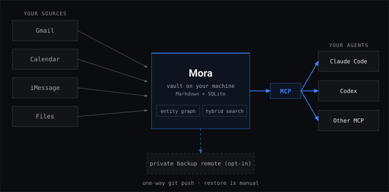

<div align="center">


# Mora

**Mora makes the AI agents you use follow the corrections you have already given them.**

[](https://github.com/pyranthus-hq/mora/actions/workflows/ci.yml)
[](https://github.com/pyranthus-hq/mora/releases)
[](LICENSE)
[](go.mod)
[](#privacy-boundary)

</div>

> [!WARNING]
> Mora is alpha software. We use it every day, and its main paths have tests.
> It has not been tested on many other people's real data. Read the cited source
> before you act on a result. A failed or old sync can make the local copy stale.

## Warn an agent when it repeats a mistake

You correct your agent, and the next session makes the same mistake. Putting the
rule in CLAUDE.md does not fix it: the agent has the rule and still breaks it.

A Mora rule checks every Bash call in Claude Code. When a call matches a rule you
approved, the agent gets your message with the result of that command and changes
what it does next. Rules are plain files on your computer.

After you [install Mora](#install):

```bash
mora rules add --id no-sudo --match '^\s*sudo\b' --message "Do not use sudo here."
mora rules approve no-sudo --mode warn   # run this in your own terminal
mora hook install --pre-tool
```

Today this is opt-in and covers Bash calls in Claude Code on one device. It warns
and never blocks. Rules drafted from your corrections, a read-only `mora check`
and the same warning in Codex are being built. See
[Bash warning rules](docs/guide.md#bash-warning-rules).

In a pre-registered test on the founder's machine, Oct 18 to 21, a prototype of
this hook ran across 63 Claude Code sessions, split at random. 17% of shell
commands repeated the mistake in warned sessions, and 65% in silent ones. That is
one developer and one habit. Outside tests are next.

## What Mora does

Mora copies the sources you choose into plain text files on your computer. By
default nothing is uploaded: backup and sharing are separate choices you turn on
yourself. You can then search everything in one place, or let an AI agent such
as Claude Code or Codex search it for you.

Mora can read:

- Gmail and Google Calendar
- iMessage, WhatsApp Desktop, and Apple Calendar on macOS
- folders and files that you choose, including PDF and Word files
- GitHub Issues from repositories that you choose

Mora only reads these sources. It does not change or delete your mail,
messages, events, or issues.

You, or an agent working for you, can also save notes and decisions into Mora.
The simplest way is the `mora write` command, which saves at once. See
[Save a memory](#save-a-memory).

What Mora does **not** do:

- It does not call an AI model when it saves or searches. An optional local
  Ollama model can improve search.
- It does not record your conversations with an agent. Only things you or an
  agent choose to save are saved.
- It does not learn from you over time, build a personal model, or check that
  your corrections still hold. These ideas are **Planned**, not built.

**Jump to:** [Install](#install) · [Add a source](#add-your-first-source) ·
[Save a memory](#save-a-memory) · [Connect an agent](#connect-an-ai-agent) ·
[Agent write policy](#agent-write-policy) · [Update](#keep-mora-up-to-date) ·
[Privacy](#privacy-boundary)

<p align="center">
  
</p>

## Install

### macOS

You need macOS and [Homebrew](https://brew.sh/) for this route. The Cask
installs the signed `Mora.app` and adds the `mora` command:

```sh
brew tap pyranthus-hq/tap
brew install --cask pyranthus-hq/tap/mora
mora version
```

This app contains the memory CLI. It does **not** include the separate desktop
companion. If Mora is already installed, read the
[migration steps](docs/homebrew.md#installation-and-updates) before using Brew.

If you do not use Homebrew, install the same signed app directly in
`~/Applications/Mora.app`:

```bash
(
  set -e
  mora_installer="$(mktemp -t mora-install)"
  trap '/bin/rm -f "$mora_installer"' EXIT
  curl -fsSLo "$mora_installer" https://raw.githubusercontent.com/pyranthus-hq/mora/main/install-app.sh
  sh "$mora_installer"
)
```

The direct installer checks the release and links `mora` to the app. Neither
install method sets up connectors, agent hooks, an agent write policy, or a
daily update job. See [Keep Mora up to date](#keep-mora-up-to-date) when you
are ready.

### Linux and Windows

Linux and older standalone macOS installs can use:

```bash
curl -fsSL https://raw.githubusercontent.com/pyranthus-hq/mora/main/install.sh | sh
```

This installer runs `mora init` and prints the commands that connect Claude
Code and Codex. It does not run them for you.

Windows users should see the [Windows guide](docs/windows.md). To build from
source with Go 1.25 or later:

```bash
go install github.com/pyranthus-hq/mora/cmd/mora@latest
```

Source builds report version `dev`. They do not update themselves. Google also
needs your own OAuth client when you build from source
(set `MORA_GOOGLE_CREDENTIALS`; see the [guide](docs/guide.md)).

## Add your first source

A folder is the quickest way to check that Mora works. It needs no account
login. Replace `~/Documents/notes` with a folder you choose:

```bash
mora init
mora connect filesystem ~/Documents/notes
mora search "a project or person"
```

Then add only the sources you want:

```bash
mora connect google                         # Gmail and Google Calendar
mora connect github --repo owner/repository # GitHub Issues
mora connect imessage                       # macOS; needs Full Disk Access
mora connectors enable whatsapp             # macOS; local read-only store
mora ingest run --source whatsapp
```

For Apple Calendar:

```bash
mora connectors enable applecalendar
mora ingest run --source applecalendar
```

`mora connect github` without `--repo` uses a built-in default list of
repositories. Pass `--repo` (repeatable) to choose your own.

Setup commands do different jobs:

| Command | What it does |
| --- | --- |
| `connect` | Sets up a source, enables it, and gets its first data. |
| `connectors enable` | Gives Mora permission to use a connector. It does not promise a data pull. |
| `ingest run` | Reads enabled sources and writes their current data into the vault. Use it for a first load or a backfill. |
| `sync` | Refreshes a source that is already set up. |

Connector data is saved as soon as it is read. It never waits for approval.
Long items are cut to keep the index lean, keeping the start of each item:

| Source | What Mora keeps |
| --- | --- |
| Gmail, Google Calendar, iMessage, WhatsApp, Apple Calendar | The first 16 KB of each item's text. |
| GitHub Issues | The first 64 KB of each issue. |
| Files and folders | Whole files; a file with more than 512 KB of text is skipped. |

## Save a memory

The main way to save a note, fact, or decision is the `mora write` command. It
saves straight into your vault, with no approval step:

```bash
mora write --scope project:acme --type decision \
  --title "OAuth" --text "Use PKCE."
```

`--title` and `--text` are required. `--scope` defaults to `global` and
`--type` to `insight`. The command prints the new memory's ID.

Agents that can run shell commands, such as Claude Code and Codex, can use the
same command. Ask them directly:

```text
When we make a decision in this session, save it with Mora, for example:
mora write --scope project:acme --type decision --title "<short title>" --text "<the decision and why>"
Show me the memory ID it prints.
```

To make this a standing rule, put the same instruction in the project's
`CLAUDE.md` (Claude Code) or `AGENTS.md` (Codex).

Everything that saves into Mora, and whether it waits:

| How it is saved | Waits for your approval? |
| --- | --- |
| `mora write` | No. Saved at once. |
| Connectors (mail, calendar, messages, files, PDF, GitHub) | No. Saved at once. |
| `mora tasks add` | No. Saved at once. |
| `mora teach ... --yes` corrections | No. Saved at once, and reversible with `mora teach undo`. |
| An agent's `write_memory` call over MCP | By default, no. It saves at once with a tag, and you review it later with `mora review`. See the [agent write policy](#agent-write-policy). |
| Claude Code hooks | Nothing is saved. Hooks only add context. |

No AI model is called on any of these paths.

## Connect an AI agent

Agents can search Mora through MCP (a standard way for an agent to call local
tools). Connect Claude Code or Codex with:

```bash
claude mcp add mora -s user -- mora mcp serve
codex mcp add mora -- mora mcp serve
```

Other MCP clients can start the same command:

```json
{
  "mcpServers": {
    "mora": { "command": "mora", "args": ["mcp", "serve"] }
  }
}
```

MCP tools cover search, reading, briefs, meetings, and people. There is also a
`write_memory` tool for agents that cannot run `mora write`; it follows the
[agent write policy](#agent-write-policy). The command line also handles setup
and maintenance.

Mora also publishes an experimental [Agent Plugins 1.0 package](plugins/mora/README.md)
that bundles the stdio MCP declaration with portable Agent Skills. It does not
install Mora, grant source permissions, or sandbox the client. Enabling it may
auto-start the local MCP server, so review the client's data policy before first
use. Its writes follow the same [agent write policy](#agent-write-policy).

## Agent write policy

This section covers only the MCP `write_memory` tool (and `delete_memory`). It
does not affect `mora write`, connectors, tasks, or teach corrections.

**Default: `tentative`.** An agent write saves at once and carries a
`mora-tentative` tag. A write waits in the proposal queue only when its type is
not `insight`, `fact`, `decision` or `task` (a `correction` changes how other
records are found, so it waits), or when its text looks like a secret, matches
the sensitive word list, or is aimed at agents. The reply says why
(`held_because`).

A tentative memory shows in search, read, list and context with a label. It
does not reach the recall hook, the digest, the brief, commitments or share.
It is a file in your vault, so `mora sync git` and `mora backup` carry it.

While notes wait, Mora says so. Each `write_memory` reply, `mora brief`, the
session-start hook and `mora doctor` show one line such as
`Agent notes not reviewed: 2 saved, 1 held.`

Run `mora review` in your own terminal to go through them. It shows each note
in full, with every field an agent acts on, and asks keep, reject, skip or
quit. A note you keep becomes owner-confirmed: agents see
`"trust":"owner-confirmed"` and are told to treat it as your own statement. If
the note changes later, that status drops. `mora review --list` prints the list
in any shell. `mora confirm <id>` keeps one note without that status, and
`mora undo <id>` removes an agent write. Under this policy `delete_memory` is
refused, and phone captures go to the queue.

The hold filter is coarse. It does not stop a false claim written in plain
words. An agent with a shell can run `mora confirm` or
`mora mcp proposals approve`, so this is not a sandbox. `mora review` refuses to
run inside an agent session, but a program that fakes a terminal or writes
vault files can still forge the owner-confirmed status. It is a review record,
not a signature.

`open`, `propose` and `readonly` stay explicit choices. v0.15.3 defaulted to
`propose`. v0.15.2 and earlier defaulted to `open`.

The setting is the `mcp_write_policy` key in `~/.config/mora/config.toml`.
`mora init` and the installers never write this key, so an install without it
uses the code default.

Set it with one command:

```bash
mora config mcp-write-policy tentative # default: agent writes save with a tag; a few kinds wait
mora config mcp-write-policy open      # agent writes save at once; deletes allowed
mora config mcp-write-policy propose   # agent writes wait for approval; deletes refused
mora config mcp-write-policy readonly  # agent writes and deletes refused
```

This writes the same key you can set by hand:

```toml
mcp_write_policy = "open"
```

`mora config` shows the policy in force. A running `mora mcp serve` reads the
setting on each call, so no restart is needed. A policy you set explicitly is
always kept across upgrades. The same policy applies to the loopback HTTP
server (`mora serve http`) and to captures from a paired phone.

Review a pending write locally before deciding:

```bash
mora mcp proposals list
mora mcp proposals show <proposal-id>
# After reviewing the full content and scope, explicitly choose:
mora mcp proposals approve <proposal-id> [<proposal-id>...]
# or: mora mcp proposals reject <proposal-id>
```

`show` is read-only. It prints the full staged arguments and effective scope,
type, and source as JSON; `--json` prints the same receipt. Common credential
patterns are masked without changing the pending file. If `redacted` is true,
reject and resubmit a proposal without credentials rather than approving the
masked view. Pattern matching cannot identify every secret.

Approval and rejection are serialized per proposal. Repeating a decision returns
a conflict, including after the published memory is deleted. An interrupted
decision remains blocked for manual reconciliation; `show` and `list` display its
recorded status and memory ID while a pending file remains. Keep the decision
records in Mora's state directory. See the [guide](docs/guide.md) for the
recovery limitations.

To give one agent its own limits, use an agent profile: the scopes it can read,
whether it can see connector evidence, and its own write policy.
`mora mcp serve --profile <name>` applies a profile to a local agent, and
`mora mcp serve-http` serves cloud agents through a tunnel that you run.
`mora remote expose` prints tunnel commands and executes none; Doctor names
profiles that loosen remote defaults. See
[Agent profiles](docs/guide.md#agent-profiles).

## Claude Code hooks

Hooks let Claude Code pull in Mora context without being asked. They are
optional and only for Claude Code; Codex and other agents get Mora through MCP
search instead. Neither `mora init` nor the installers add them.

```bash
mora hook install
mora hook status
```

- The `SessionStart` hook adds the latest Mora brief when a session starts. It
  does not search.
- The `UserPromptSubmit` hook searches Mora for each prompt and adds up to three
  short matching memories. It skips prompts under 12 characters and slash
  commands, and gives up after 0.7 seconds.

Both hooks only read. They save nothing, and Mora has no hook that records the
conversation. Mora keeps existing valid Claude hooks. It refuses to rewrite a
settings file that it cannot parse.

For corrections scoped to one project, run this from that project's root:

```bash
mora hook install --project --scope project:my-app
mora hook status --project
```

This installs recall in `.claude/settings.local.json`, includes only the exact
`project:my-app` scope, and omits the global brief. Save corrections with the same
`--scope`. It requires Claude's hook `cwd` to be inside the installed directory;
missing or outside directories inject nothing. Remove it from that root with
`mora hook uninstall --project`. If global Mora hooks are installed, the project
installer asks you to remove them first with `mora hook uninstall`.
Project hook commands reject `CLAUDE_CONFIG_DIR`, linked worktrees, and symlinked
Claude settings. In a Git repository, run them from the main checkout root.
Duplicate managed local hooks are refused without writing. The binding covers the
directory subtree, including nested repositories; moving the root requires a new
installation. Adding global hooks later can reintroduce context from other scopes.
The plain global install still reads across scopes. These hook settings do not
restrict MCP tools or memories an agent has already read.

## Check health and add a schedule

```bash
mora doctor
mora schedule install ingest-hourly
mora schedule install pulse-daily
mora schedule list
```

On macOS, jobs from a signed app launch through `Mora.app`. This lets macOS use
the app's Full Disk Access identity. Mora records its own sync result because
the macOS app launcher does not return the inner command's exit code.

## Full Disk Access on macOS

iMessage, WhatsApp, and Apple Calendar are local, but macOS still protects their
files. Mora cannot grant this permission for you.

1. Install the signed `Mora.app` first.
2. Open **System Settings**.
3. Open **Privacy & Security**, then **Full Disk Access**.
4. Press **+** and choose `/Applications/Mora.app` for a Homebrew install, or
   `~/Applications/Mora.app` for a direct install. Press Command-Shift-G to enter
   the path if needed.
5. Turn Mora on. If macOS asks, quit and reopen the app or terminal.
6. Run `mora doctor`.
7. Run `mora sync imessage`, `mora sync whatsapp`, or `mora sync applecalendar`.

If an old Mora entry is present, keep it until the new app passes `mora doctor`
and a protected sync. Then remove the old entry yourself. After an update,
repeat those checks and grant access again if macOS asks. Never replace only
the executable inside `Mora.app`; that breaks its signature. The
[guide](docs/guide.md#full-disk-access-on-macos) covers older installations.

## Ask an agent to set it up

Copy this prompt into an agent that can run local shell commands:

```text
Install Mora from the official pyranthus-hq/mora repository and set up a small,
safe first run. On macOS, use the signed Mora.app Homebrew Cask, or the direct
signed-app installer if I do not use Homebrew. Verify `mora version` and run
`mora doctor`. Ask me before any Google
OAuth approval, GitHub token use, Full Disk Access change, backup, sharing, or
schedule install. Do not say you clicked or approved a system screen. I will do
those steps myself. Start with one folder that I choose, connect it, run a test
search, then offer to wire `mora mcp serve` into my agent. Report every command,
what it changed, and any check that did not pass.
```

## Use Mora every day

```bash
mora brief                                      # what changed and what matters
mora search "What is open with Sam?"           # direct recall
mora think "What did we decide about pricing?" # evidence plus gaps for an agent
mora write --scope project:acme --type decision \
  --title "OAuth" --text "Use PKCE."            # save a decision
mora brief --event-id calendar_event/abc        # cited meeting prep
mora tasks list                                 # open local tasks
mora review                                     # keep or reject what agents saved
mora doctor                                     # source and index health
```

Useful flows:

- Start a work session with `mora brief`.
- Search for a person, project, issue, or decision with `mora search`.
- Use `mora think` when the answer needs several pieces of evidence.
- Save a note, fact, decision, or insight that you want agents to remember with
  `mora write`. It saves at once.
- Use `mora brief --event-id <id>` before a meeting.
- Capture and close small local tasks with `mora tasks add`, `list`, and `done`.
- Run `mora doctor` when results look old or incomplete.

## Correct or remove memory

Mora can propose that two addresses belong to the same person. It never accepts
the match on its own.

```bash
mora teach identity list
mora teach identity confirm --handle <phone> --email <address> --yes
mora teach identity reject --handle <phone> --email <address>
```

You can correct a cited commitment or a note that you wrote:

```bash
mora teach commitment wrong-direction --memory-id <id> --direction owed_by_self --yes
mora teach commitment already-closed --memory-id <id> --yes
mora teach memory correct --id <id> --title "Correct title" --text "Correct text" --yes
mora teach history --memory-id <id>
mora teach undo <ledger-id>
```

`mora delete` removes one memory now. A later source sync can restore connector
data. Use `mora forget` when the removal must remain after sync:

```bash
mora forget --chat <stable-id> --dry-run
mora forget --chat <stable-id> --yes
mora forget list
mora unforget <entry-id> --yes
```

Forget changes only Mora's local copy. It never deletes the source message,
event, or issue.

## Backup and sharing are separate choices

Mora offers three different paths:

| Path | Leaves this computer? | Encryption added by Mora? | Use |
| --- | --- | --- | --- |
| `mora backup` | No | No | Make a local `.tar.gz` copy in Mora's state directory. |
| `mora sync git` | Yes, if the remote is off-device | No | Push the plaintext vault to a git remote you control. |
| `mora share` | Yes | Yes, with age | Send only authored memories from one scope through a git remote or an S3-compatible bucket you control. |

The vault contains plaintext. A git remote is protected only by its access
rules, not by Mora encryption. `mora share` encrypts before upload, but the remote can
still reveal file sizes and update timing. A person who already downloaded a
share keeps that copy.

See the [guide](docs/guide.md#backup-and-sharing) before you enable a network
path.

## Browser access on this computer

An agent that cannot start a local process can use Mora's loopback HTTP server:

```bash
mora serve http
# or keep it running as a user service
mora serve http install
mora serve http status
```

It binds only to `127.0.0.1`, uses a bearer token, and does not enable CORS.
Loopback means this computer only. It is still a local security boundary: any
process that gets the token can call the allowed routes. The generic HTTP call
route does not expose `delete_memory`.

## Durable loops

Long-running automation can record a lease and a result. This prevents two
workers from doing the same scheduled work at once.

```bash
mora loop register daily-report --cadence daily --command "my-report-command"
mora loop begin daily-report
mora loop heartbeat daily-report --run <run-id>
mora loop done daily-report --run <run-id> --ok
mora loop status daily-report
mora loop list
```

The built-in daily brief uses this system. A crash can leave a run marked
uncertain. Inspect it before you repeat an outside action.

## Keep Mora up to date

Choose the command for your install method. A new release must be published
before either route can install it.

| Installed with | Update command |
| --- | --- |
| Homebrew Cask | `brew update` then `brew upgrade --cask pyranthus-hq/tap/mora` |
| Direct signed-app installer | `mora upgrade` |
| Go source build | Run `go install` again. Source builds do not self-update. |

Installing the app does **not** set up automatic checks. To enable Mora's daily
update job for a signed app, run:

```bash
mora upgrade --policy auto
mora schedule install update-daily
mora schedule list
mora upgrade --status
```

The first command saves the policy; the second installs the job. `notify`
checks for releases and reminds you instead of installing them. `off` stops
scheduled checks. A Brew-managed app may need a manual `brew upgrade` if Mora
cannot replace its app bundle. The [update guide](docs/guide.md#update) explains
the checks, rollback, and recovery path.

After any update, run `mora version` and `mora doctor`. If you use iMessage,
WhatsApp, or Apple Calendar, also run a sync for that source to check that macOS
still lets Mora read it.

## Uninstall

```bash
mora schedule list
mora schedule uninstall <each-job-name-shown>
mora hook uninstall
mora serve http uninstall
```

Remove the jobs shown by `mora schedule list` before you uninstall the app.
Then use `brew uninstall --cask pyranthus-hq/tap/mora` for a Brew install, or
the checked `uninstall-app.sh` command in the [guide](docs/guide.md#uninstall)
for a direct install. Both leave your saved data in place; neither removes
scheduled jobs for you.

## Data layout

| Path | Holds | Can Mora rebuild it? |
| --- | --- | --- |
| `~/vault/mora` | Markdown memories | No. Back it up. |
| `~/.local/share/mora` | SQLite index and received shares | Yes, except received share data must be pulled again. |
| `~/.local/state/mora` | Sync state, local usage log, local backups | Usually. |
| `~/.config/mora` | Settings, OAuth tokens, share keys | No. Reconnect or restore it. |

Run `mora config` to see the active paths. `MORA_VAULT` can select another
absolute vault path for one process. It does not change `config.toml`.

## Privacy boundary

- Source access is read-only. Google uses `gmail.readonly` and
  `calendar.readonly`. iMessage uses `mode=ro`. Apple Calendar uses `mode=ro`
  plus SQLite `query_only(1)` so it can read the live write-ahead log safely.
- The vault, index, tokens, sync state, and usage log stay local by default.
- Mora uses the network for source APIs, GitHub release checks, and any backup
  or share target that you choose. Pushing authored memories to a company
  memory service (`mora eywa push`) is off until you enable it and asks first.
- No AI model is called when Mora saves or searches. The default embedder is
  `static`, which runs no model.
- Optional Ollama embeddings are allowed only on a loopback address.
- Mora's local usage log leaves out query text by default. Turn it off with
  `mora usage off` or `DO_NOT_TRACK=1`.
- A cloud agent is a separate boundary. After it reads a Mora result, its model
  provider and data rules apply.
- Files are plaintext on disk. Use FileVault, BitLocker, or other disk
  encryption. Do not put the vault in an unencrypted remote.

## Search and proof

With the default static embedder, Mora searches parent memories and bounded
Gmail/iMessage message segments with full-text search. With an active semantic
Ollama embedder, it combines full-text, vector, person-graph, and message-segment
results with Reciprocal Rank Fusion. That name means it joins ranked lists by
position instead of comparing unrelated raw scores.

Mora's frozen test corpora start from a written answer key. Tests render mail,
messages, and events from that key, pin every byte, run the real brief and
meeting code, and check citations and commitment fields. Mutation tests also
break each important gate on purpose and require a test to fail. This is strong
proof against known regressions. It is not proof that every real inbox or
calendar will work.

The fixtures and scores are in [`internal/mora/eval/`](internal/mora/eval/).
The method is in [evaluation and testing](docs/architecture/09-eval-and-testing.md).

Source receipts include the observation and attempt times, last success, next
expected run, duration, freshness budget, consecutive failures, and a
correlation ID. A source cannot report `fresh` unless its observation and last
success both fall inside that budget. Search evidence manifests carry the
ingest correlation ID for each cited memory plus a deterministic query ID;
sanitized stage events live only in Mora's state directory under
`observability/traces.jsonl`. Doctor uses the same ID as its diagnostic evidence
link. Trace events never contain source content or local paths.

## More

- [Guide](docs/guide.md): commands, connectors, and upkeep.
- [Architecture](docs/architecture/00-overview.md): current design and code map.
- [Contributing](CONTRIBUTING.md): build and review rules.
- [Security](SECURITY.md): how to report a security problem. Never paste vault
  data or credentials into a public issue.

---

<div align="center">
<sub>Named for <strong>Hermaeus Mora</strong>, keeper of knowledge and memory.</sub>
</div>
