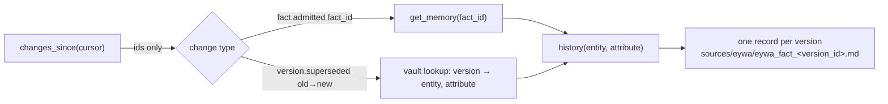
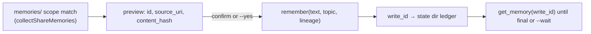

# 24 — Eywa connector (company memory)

Eywa is a governed company memory service with an agent MCP API. A company
runs it; agents read admitted facts from it and propose updates to it, and the
service decides what is admitted. This connector does two separate things:

- **Pull** (a normal connector sync): admitted facts come into the vault as
  read-only evidence records, with their citation and lineage.
- **Push** (an explicit owner action, off by default): one scope of authored
  Mora memories goes to the service as agent updates with lineage. The service
  governs each update: it may admit it, send it to curator review, or hold it.

Mora ships no default endpoint, tenant, account, or region. Every value is
the user's.

## Files

| File | Responsibility |
|---|---|
| `internal/eywa/eywa.go` | Kind registration (`eywa_fact`, type `fact`, provider `eywa`), endpoint validation (HTTPS, or HTTP only for loopback), and the typed errors: `AuthError` (declares `ConnectorUnauthorized`), `RateLimitError` and `UnavailableError` (declare `ConnectorUnavailable`), `ForbiddenError`, `ToolError`, `RPCError`. |
| `internal/eywa/client.go` | OAuth2 `client_credentials` token (HTTP Basic client auth, optional scope, cached until a minute before expiry), and a minimal MCP client over streamable HTTP: `initialize` → `notifications/initialized` → `tools/list`, JSON or `text/event-stream` answers, `Mcp-Session-Id` and `MCP-Protocol-Version` headers, one re-initialize on an expired session, one token refresh on a 401, one bounded wait for a short `Retry-After`. Tool names are resolved by their bare name, so a gateway prefix such as `<target>___changes_since` works. |
| `internal/eywa/pull.go` | The `memory.Fetcher` over `changes_since`, the change → version resolution, the read-only record rendering, and `MapFact`. |
| `internal/eywa/push.go` | `BuildUpdate` (text, lineage, idempotency key), `Remember`, `GetWriteStatus`, and `FinalStatus`. |
| `internal/mora/eywa.go` | Composition: secret from the environment, `connect eywa`, `sync eywa`, the vault lookup of known versions, and the `mora eywa push/preview/status` commands with their preview, confirmation, and state-dir push ledger. |

`internal/eywa` imports only `internal/memory` and `golang.org/x/text` (already
a direct dependency) for NFC normalization. It never imports `internal/mora`.

## Configuration and secrets

`mora connect eywa --endpoint <mcp-url> --token-url <url> --client-id <id>
[--oauth-scope <scope>] [--agent-id <id> --topic <topic>]` saves a
`memory.EywaSettings` value on the `eywa` row of `sources.json`. The client
secret is never written anywhere: it is read from `MORA_EYWA_CLIENT_SECRET` at
the start of each sync or push, like `MORA_GITHUB_TOKEN`. A token is kept in
memory for one process only. Error messages never include the secret, the
token, or the token endpoint's response body.

`mora connectors enable eywa` flips the enabled bit only when settings exist;
otherwise it prints how to configure the connector and creates no row, the
same rule the filesystem connector follows for a missing folder.

## Pull

- **Cursor.** The first sync calls `changes_since` with `since` = now minus
  `since_days` (default 35, clamped to the feed's 35-day horizon). Every page's
  `next` is reported as the page `SyncCursor`, so `memory.Ingest` commits it to
  `IncrementalCursor` in the state-dir `SyncStatus` only after every page was
  walked. Later syncs resume from that cursor. A cursor the service rejects
  (`-32602`) maps to `memory.ErrIncrementalCursorExpired`, and the loop falls
  back to a fresh walk.
- **Resolution.** The feed carries ids, never values. A `fact.admitted` change
  is resolved with `get_memory(fact_id)` for the current version and its full
  lineage (source URI, content hash, signer, excerpt), then
  `history(entity, attribute)` for every version of that fact. A
  `version.superseded` change names only version ids, so the connector finds
  the entity and attribute in records the vault already holds. A replacement
  of a version the vault never pulled is skipped and counted in a note, not
  treated as an error.
- **Records.** Each version is one Markdown record with StableID
  `eywa_fact/<version_id>`, type `fact`, provider `eywa`. The body states the
  entity, attribute, value, status, valid and recorded times, and a citation
  line `Citation: <source_uri> @ <version_id>`, followed by the cited excerpt.
  `meta` repeats these fields for retrieval. Records are evidence
  (`eywa_fact/` is a connector id prefix in `internal/memory/provenance.go`), so
  they can never be pushed back.
- **Replaced versions.** A version the service retired is rewritten with
  `status: replaced`, its `retired_at`, and `replaced_by` when the feed said
  which version replaced it. It is never tombstoned or deleted. History rows
  carry only the source URI, so the lineage an earlier sync stored is merged
  back in rather than lost. This is the service's explicit statement, not a
  Mora inference, so it does not conflict with the `later_related_evidence`
  rule.
- **Own updates.** `write.status` changes about this agent's own updates are
  counted but not written; `mora eywa status` reads them.

## Push

- **Off by default.** `mora eywa push enable` sets `push_enabled` on the
  source row, and it needs the agent id and scope topic. Re-running `connect`
  never changes it. `mora eywa push disable` turns it off.
- **What may leave.** The selection is exactly `mora share`'s:
  `memories/` only, one exact scope, no tombstones, no provider-stamped
  records, no hidden Teach revisions, no symlinks. Pulled facts and every other
  connector record are structurally out of reach. Pending propose-mode MCP
  proposals live outside the vault and cannot be pushed until the owner
  approves them.
- **What is sent.** For each new or changed memory: `text` (the title and body,
  NFC, trimmed, at most 8000 characters; a longer memory is refused and listed,
  never trimmed), `topic` (the configured scope topic), and `lineage` with
  `source_uri = eywa-run://<agent-id>/mora/<memory-id>`, `excerpt` = the text,
  and `content_hash` = SHA-256 hex of the canonical text, so the service's
  lineage check verifies exactly what was sent. No signer is claimed (the token
  identity is the writer) and no effective date is set. The idempotency key
  combines the content hash and memory id, so a retried send is not duplicated.
- **Consent.** `mora eywa preview --scope <scope>` prints the full text of
  every update and sends nothing. `mora eywa push` prints the list (id, title,
  source URI, content hash, length) before the confirmation; a non-interactive
  run without `--yes` is refused (`confirmEywaPushFn`, the same seam pattern as
  `confirmSharePushFn`).
- **Outcome.** Each `write_id` is recorded in
  `<StateDir>/eywa/push-eywa.json` (ids, hashes, statuses; never text) before
  polling starts. `get_memory(write_id)` is polled until every write has a final
  status (`admitted`, `admitted-unchanged`, `in_review`, `held`, `rejected`,
  `no-fact`) or `--wait` elapses. `in_review` and `held` are reported as the
  service's governance decisions. `mora eywa status` re-checks writes still
  `received`. An unchanged memory is not re-sent.
- **MCP write policy.** Push is not an MCP tool, and the 13-tool catalog is
  unchanged. No agent can trigger egress under any `mcp_write_policy`; only
  the owner's CLI can.

## Errors

| Failure | Pull | Push |
|---|---|---|
| Token endpoint refuses the client (400/401) | `AuthError` → `connector.unauthorized`, run fails, checkpoint kept | stops before sending |
| MCP 401 | token refreshed once, then `AuthError` | same |
| MCP 403, or JSON-RPC Forbidden on session calls or `changes_since` | `AuthError` (agent revoked, unknown, or no scope) | `remember` Forbidden → `AuthError` naming the topic |
| HTTP 429 or JSON-RPC `-32002` | waits once when `Retry-After` ≤ 30 s, else `RateLimitError` (with the delay) → `connector.unavailable` | same; sent updates stay recorded |
| 5xx or `-32004` | retried once after a short wait, then `UnavailableError` → `connector.unavailable` | same; unsent updates stay pending |
| Forbidden or tool error on one lookup | per-record failure: counted as a dropped item, named in `last_error`, run reported incomplete | a tool error (for example `GuardrailBlocked`) fails that update only and the command exits non-zero |

No failure is swallowed (honest-snapshot rule): partial pulls and partial
pushes both exit non-zero and say what happened.

## Network boundary

Pull and push reach only the endpoint and token URL the user configured, over
HTTPS. Pull is source sync egress, like Google or GitHub. Push is opt-in
egress, like `mora share`, and it sends authored memory text in plaintext over
TLS to a service the user's company operates. Usage logging records only the
tool name and a count (`eywa_push`) and honors `DO_NOT_TRACK` and
`mora usage off`.

## Tests

`internal/eywa/*_test.go` run an `httptest` fake of the service (token
endpoint plus MCP endpoint behind a gateway-style tool prefix, JSON and event
stream answers, session expiry). They cover the cursor across two syncs,
replaced versions keeping earlier lineage, per-record failures, typed
401/403/429 handling with `Retry-After`, cursor fallback, lineage hashing (NFC,
trim), and the `in_review` result. `internal/mora/eywa_source_test.go` drives
`connect`, `sync`, `enable`, `preview`, `push`, and `status` through `Run`
against a second fake. Everything runs offline with no credentials.
