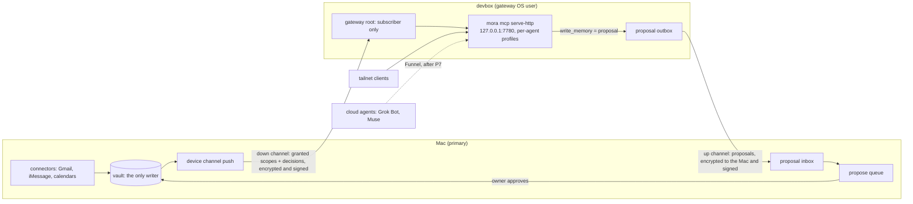

# Design: an always-on gateway node (devbox)

**Status: draft for review. The plan is not adopted.** The owner answered three
security calls on 2026-10-15 (section 11), on the condition that the plan goes
ahead. The pilot order (D4) is still open. No code, host or client changes until
the owner adopts the plan.

This document plans how a small always-on Linux host can serve one user's Mora
memories to remote agents. It uses the owner's own setup as the worked example:

- **the Mac**: the primary install. It runs every connector and holds the only
  writable vault.
- **white-nova**: a WSL box that runs the current gateway (`mora mcp serve-http`
  from PR #547) behind Tailscale Funnel, for two cloud agents, Grok Bot and Muse.
- **devbox**: a Linux VPS on the tailnet. It runs a headless agent workbench
  (Orca) and its own Mora 0.15.1, which subscribes to 8 encrypted shares from
  the Mac.

The proposal: move the gateway role from white-nova to devbox. The Mac stays the
only connector host and the only writable vault. The plan does not make devbox
a primary vault and does not add multi-writer sync.

## 1. What exists today (measured 2026-10-15)

| Fact | Evidence |
|---|---|
| The Mac publishes 24 shares and subscribes to 8: 32 single-scope repos in all. | `mora share list` on the Mac |
| white-nova serves 12 scopes to 2 profiles (`grok`, `muse`). Both profiles hide raw sources and propose writes. | gateway deployment notes, 2026-09-28 |
| devbox subscribes to 8 scopes (`devbox-*`) and publishes 8 back (`from-devbox-*`). A system timer runs a hand-written sync script every 15 minutes. | `systemctl list-timers`, `/etc/systemd/system/mora-share-sync.*` on devbox |
| Each devbox pull reports every memory as "new/updated" even when the remote did not change (for example `470 new/updated, 0 removed, 470 total`). One cycle of 16 shares takes about 60 s. | devbox journal, 2026-10-16 00:32Z |
| Approving a proposal on white-nova writes the gateway's own vault. The Mac never receives it, so local agents never see what the cloud agents saved. | live check, 2026-09-28 |
| Proposal staging is not idempotent. A retried `write_memory` stages a second proposal with a new id. | `stageMCPWriteProposal`, `internal/mora/mcp_policy.go` |
| Approval writes the memory, then deletes the pending file. A crash between the two leaves the proposal pending, so a second approval writes a duplicate. | `cmdMCPProposals`, same file |
| `mora mcp proposals list` shows only scope, type and title. There is no command to read a proposal's full text before approval. | same file |
| `list_memory` through a gateway lists only the gateway's own (empty) vault, not its subscriptions. | live check, 2026-09-28 |
| A share's recipients are fixed at `share init`. No verb adds one later. | `internal/mora/share.go` |
| PR #547 (profiles + `serve-http`) is open, not merged. white-nova runs a branch build. devbox's 0.15.1 release has no profiles. | `gh pr view 547` |

## 2. Goals and non-goals

Goals:

1. One always-on endpoint that remote agents can call when the Mac sleeps.
2. Agent writes reach the Mac's vault, after the owner approves them, and come
   back to every agent through the normal share push.
3. Far fewer repos and less hand-written glue per device.
4. A design that any open-source user can run for themselves on their own host.

Non-goals:

- devbox as a primary or second writable vault (option C).
- Multi-writer vault sync, conflict merge or replicated deletes (#517, option D).
- A relay or blob store with no agent endpoint (option B on its own).
- Connector data on the gateway. `sources/` cannot be shared by design
  (`collectShareMemories`, [13-sharing](../architecture/13-sharing.md)).
- Pooled multi-tenancy. One gateway serves one user's grants (section 9).

## 3. Target topology



The parts:

- **Gateway root.** A separate Mora root on devbox, under its own OS user, with
  its own `MORA_CONFIG_DIR`, data dir, state dir and vault. It only subscribes.
  Its local vault stays empty, because agent writes become proposals, never
  local memories. Its age and signing keys are created on devbox and never leave
  it. The Orca agents that run as the main user cannot read its keys, tokens or
  profile store (decision D3).
- **`mora mcp serve-http`** (PR #547) binds `127.0.0.1` only. Each bearer token
  selects one profile. The server reloads the profile store on every request,
  so `revoke` and `rotate` take effect at once. Default remote profile: granted
  scopes only, `raw_sources=false`, `write=propose`, no `delete_memory`.
- **Exposure.** Tailscale first: `tailscale serve` for tailnet clients. Grok
  Bot and Muse run in the cloud and are not on the tailnet, so they need Funnel.
  Funnel waits until the per-token rate limit (P7) lands, and `--allow-host`
  names devbox only (decision D2). `mora remote expose` (PR #555) prints the
  commands and runs none.
- **Writes.** Every profile is `propose`. The gateway never writes a memory.
  Proposals travel to the Mac (section 4).
- **The Mac** keeps every connector, every plaintext source and the only
  writable vault. It approves proposals and publishes the results.

Two layers enforce scope on the gateway. First, the gateway only ever decrypts
the scopes granted to it, so an ungranted scope is not on the host at all.
Second, each profile filters results to its own scopes. The second layer is
the #547 post-ranking filter. On a gateway whose corpus holds only granted
scopes, that filter is defense in depth. It is still the only boundary between
two profiles with different scope sets.

## 4. Proposal return path

Today a proposal staged on the gateway can only be approved on the gateway, and
approval writes the wrong vault. The return path moves each proposal to the
Mac, lets the owner decide there, and tells the gateway the outcome.

### 4.1 Flow

1. **Stage.** A remote agent calls `write_memory`. `admitAgentCall` stamps
   `source: agent:<name>`. The profile's `propose` policy stages a proposal on
   the gateway with a **request id**. A client may send its own request id;
   otherwise the gateway derives one from (profile, canonical arguments) and
   keeps it for a retry window (default 24 hours). A retry with the same
   request id inside the window returns the existing proposal and stages
   nothing. After the window, an identical note is a new proposal, so the
   gateway never suppresses an intentional repeat forever.
2. **Export.** The scheduled sync encrypts each new proposal to the Mac's age
   recipient and writes it into the device's **up channel** (section 5). The
   gateway signs the channel manifest with its ed25519 key. Each manifest names
   its version and the hash of the manifest before it. The proposal moves to
   state `exported` only **after** the push is durable on the remote. A failed
   push leaves it `pending` and shows as an error in health.
3. **Import on the Mac.** The Mac pulls the up channel. In order, it:
   - verifies the signature against the device key it pinned at pairing;
   - refuses a version at or below the stored floor, and a manifest whose
     predecessor hash does not match the last accepted one. A fork or a gap
     marks the device `diverged` in health and imports nothing;
   - decrypts and validates each proposal with the same checks as a local
     write (`mcpMemoryFromArgs`, `validateDispositionPublish`, size cap);
   - checks the proposal's scope against **the Mac's own device ledger**. A
     device may propose only into a scope it holds both a read grant and a
     propose grant for. The Mac never trusts the gateway's claim about what its
     agent may do;
   - records attribution as **claimed agent via verified device**:
     `proposed_by: agent:<name>`, `via_device: <device>`. The signature proves
     the device, not the agent. A compromised device can claim any agent name;
   - records `(device, request id)` in the inbox ledger, then stages the
     proposal in the Mac's normal propose queue with `received_at` set from the
     Mac's clock.
   A second import of the same proposal is a no-op.
4. **Decide.** The owner runs `mora mcp proposals show <id>` (new: full text,
   device, claimed agent, scope, and any look-alike pending proposal by content
   hash), then `approve` or `reject`. Approval re-checks the device's grants and
   the expiry at that moment, not only at import. Approval is **idempotent**:
   the new memory's id is derived from (device, request id) and written with
   create-exclusive publish, so a second approval after a crash finds the memory
   already present and only finishes the bookkeeping. The memory carries
   `source: agent:<name>`, `via_device` and `proposal_id`.
5. **Report back.** The Mac adds a decision record to the device's **down
   channel**: request id, `approved|rejected|expired`, and `decided_at`. An
   approved record also carries the memory id, which the device can already see
   because it holds a read grant for that scope. On its next pull the gateway
   marks the proposal decided and deletes its pending copy. The approved memory
   arrives through the same down channel, so every agent on the gateway can
   find it.

### 4.2 Storage

| Data | Place | Why |
|---|---|---|
| Device ledger: keys, grants, version floor, last manifest hash | `<ConfigDir>/devices.json` (0600) | It must be as durable as the device pin, like `LastVersion` in `shares.json` today. Losing it would let an old manifest replay. |
| Inbox ledger: `(device, request id)` → state | `<ConfigDir>/device-inbox/<device>.json` (0600) | Same reason: it is the replay fence. |
| Pending proposals on the Mac | the existing `<ConfigDir>/mcp-proposals/` | One queue for local and remote proposals. |
| Outbox, retry-window keys, receipts on the gateway | gateway state dir | Device-local bookkeeping, never the vault. |
| Decision records | the down channel only | They are content-free and kept for 90 days, then garbage-collected. |

Nothing in this table enters any vault or vault backup.

### 4.3 States and visibility

Each proposal has one visible state: `pending → exported → received →
approved | rejected | expired`. An approved proposal is committed on the Mac
before it is searchable on the gateway. The gap is one push and one pull, and
health says which side of it the proposal is on.

- The Mac's `brief` and `doctor` report the inbox: count pending per device and
  the age of the oldest. Proposals that wait do not rot in silence.
- The gateway's health reports the outbox: count not yet exported, count
  awaiting a decision, oldest age, and the last successful export. A failed
  export is an error, never a silent skip (honest-snapshot rule).
- Proposals expire 30 days after `received_at` on the Mac's clock
  (configurable). The device's own timestamps never set expiry, so a device
  cannot backdate a proposal into expiry, and a proposal does not expire while
  the Mac sleeps before import. Expiry is recorded and reported like any other
  decision.
- The connect text from #547 stays: a queued proposal is finished, and the
  agent must not poll for its approval.

### 4.4 Later: updates and stale bases

`write_memory` creates memories only today, so a proposal cannot conflict with
a newer version of the same memory. If update proposals are added later, each
must carry the content hash of the version it edits. Approval then refuses a
proposal whose base changed, and reports it as stale. That is out of scope here.

## 5. Device channels: a multi-scope device share

### 5.1 The problem

Today each (scope, recipient) pair is its own share and its own private repo.
The Mac runs 32 of them. Adding the devbox gateway with today's commands means
8 more, because a share's recipients cannot be extended. Each device also needs
hand-written launchd or systemd glue.

### 5.2 The design

A **device channel** carries every scope granted to one device through one
transport location. Each device gets two channels:

- **Down** (Mac → device). The Mac is its only writer. It holds the scope
  corpora granted to that device and the decision records from section 4.
- **Up** (device → Mac). The device is its only writer. It holds proposals.

Layout on either transport (git repo or bucket prefix). Object names are opaque
hashes, so a reader of the raw repo learns sizes and counts, not scope names or
memory ids:

```text
index.age                 age-encrypted, ed25519-signed: channel id, device id,
                          version, predecessor hash, grant list
                          [{scope, key_epoch, granted_at}], and one entry per
                          scope: the hash of that scope's manifest
s/<hash>.age              down: one encrypted manifest per scope
                          {memory id -> blob hash}
b/<hash>.age              down: one encrypted blob per memory
d/<hash>.age              down: encrypted decision records
p/<hash>.age              up: encrypted proposals
```

This follows the rule from
[14-share-transports](../architecture/14-share-transports.md): write
content-addressed ciphertext, then flip one signed manifest. Three changes
from the single-scope share:

- **The index is encrypted and signed on both transports.** On git, write
  access alone is too weak an authenticity check once one repo carries many
  scopes, and the gateway host may hold a credential with wide write access
  (threat T2).
- **Manifests are sharded per scope.** The signed index lists one hash per
  scope, not one entry per memory, so it stays small. A push rewrites only the
  scope manifests that changed. Each scope imports as its own generation, so a
  broken scope fails alone and the others keep serving.
- **The same import checks run.** A device-channel pull materializes each scope
  into the existing v1 layout and runs the existing `shareImport` backstop:
  id-spoof, scope-mismatch, size, unsafe names, the ciphertext-only egress
  allowlist, the origin check, the storage bound and per-generation digests.

What stays the same per scope:

| Property | How the device channel keeps it |
|---|---|
| **Per-scope grants** | The Mac's device ledger has one row per (device, scope): `granted_at`, `revoked_at`, `key_epoch`, and whether the device may propose into it. A push includes only scopes with a live grant. The signed grant list travels in the index, and the device refuses to serve a scope that is no longer listed. |
| **Per-scope recipients** | Every blob is encrypted to that device's key alone. A scope granted to two devices is encrypted once per channel, so revoking one device never forces a re-encrypt for the other. That costs N copies for N devices, which is small for one user. |
| **Per-scope revocation** | Revoke the grant. The next push drops that scope from the index, and an honest device deletes its copy on the next pull. Revocation fences **future** updates only: the device keeps what it already pulled, and git history keeps old ciphertext. Cutting a device off from history means rotating: a new device key, a new channel location, and a re-encrypted head. A `key_epoch` bump records that rotation; the number alone rotates nothing. |
| **Attribution** | On the device, each scope keeps its own generation index under `subs/<channel>/<scope-slug>/`, so rows still carry an owner label chosen by the subscriber. On the Mac, proposals carry `agent:<name>` as claimed and `via_device` as verified. |
| **Per-scope health** | Health is per (channel, scope). One stale or broken scope does not hide behind a healthy channel. |

**Device-authored memories.** devbox's own Mora (the Orca agents' local vault)
publishes 8 `from-devbox-*` shares today, which the Mac reads as a read-only
shared corpus. That stays a read-only corpus: a device channel must never
import a device's memories into the Mac's vault, or it becomes #517 by the back
door. The gateway root has no local memories, so its up channel carries
proposals only. Whether devbox's own Mora moves its `from-devbox-*` corpus onto
a device channel, or keeps it as single-scope shares, is a later choice.

**Publication consent.** Today `share push` previews the exact add, update and
remove set and asks before anything leaves. A scheduled push cannot ask. The
device channel replaces the per-push question with a **standing grant**:
`mora device add` and every grant change show the full scope list and the
memory count per scope, and ask once. Each scheduled push then appends its
counts per scope to a local disclosure log that `doctor` shows. A push whose
scope set differs from the confirmed grant refuses to run. This changes a rule
in [13-sharing](../architecture/13-sharing.md), so that document must change
with the code.

**Count.** For this setup: devbox's own Mora and the gateway root are separate
devices (D3), so devbox needs 4 channels in place of 16 repos and the 8 new
repos a gateway would add. Each other device needs 2.

**Pairing.** `mora device add <name>` on the Mac prints a join command.
`mora device join` on the device creates its keys and prints its recipient and
signing fingerprint. The owner confirms the fingerprint on the Mac.
`mora schedule install share-sync` (PR #577) replaces the hand-written sync
scripts.

**Migration from single-scope shares.** Side by side, one scope at a time:
grant the scope on the device channel, pull, and compare the corpus digest with
the old subscription's. When they match, the device drops the old
subscription and the Mac removes the old share. Rollback for a scope is to keep
the old share until its digest matches. Old repos are archived only after every
scope on them has moved.

### 5.3 How this differs from #517

#517 is private multi-writer vault sync: several installs converge on one
writable vault, so it needs merge rules, conflict records, replicated
tombstones and resurrection guards.

A device channel needs none of that:

- Each channel has **exactly one writer**. Nothing merges.
- The device never writes the Mac's vault. Its writes reach the vault only
  through the owner's approval, one proposal at a time.
- The device holds a **snapshot**, not a replica. Deleting a memory on the Mac
  drops it from the next manifest. The device cannot resurrect it, because its
  only path back is a proposal that a human reviews.
- Authority stays on one host. A suppression or a Teach decision on the Mac
  needs no replication protocol.

It is still a new protocol. It needs transactional snapshot publication,
bounded manifests, per-scope failure isolation, key rotation, crash recovery
and the migration above. Those are the costs of section 5.2, and they are much
smaller than conflict semantics.

#517 stays deferred. This design is the "shared read endpoint" that #517 says
must fail before multi-writer sync is worth building.

## 6. Prerequisites and owners

| # | Prerequisite | Why the gateway needs it | Owner | State (2026-10-15) |
|---|---|---|---|---|
| P1 | #547 merged and released: profile enforcement on every HTTP read and mutation. Includes the receipt-warning work (#568) and the Windows CI fixes sequenced behind it (#569, #570). | devbox runs releases, not branch builds. #539's acceptance still asks for authorization before ranking or an explicit revised contract. | #539 integration owner | Open, mergeable, head frozen pending those fixes |
| P2 | #576: `context_memory` reads shares; `brief` points at them | A subscriber-only gateway otherwise looks empty at session start. | #576 author | Draft PR. Partial: brief points rather than summarizes, and the current-state and open-loops intents get a pointer only |
| P3 | No-op pull short-circuit with honest Imported and Removed counts | Each 15-minute pull now rebuilds every share and reports false counts. | Share-pull work, in progress on a separate branch | In progress |
| P4 | Share health split from personal index health | A stale subscription must not turn the personal index banner red, and the gateway needs per-share health. | Unassigned; may fold into the index-freshness work in progress | Not started |
| P5 | `list_memory` reads subscribed shares | Through a gateway it lists only the empty local vault. | Unassigned | Gap since 2026-09-28 |
| P6 | Proposal return path (section 4): request ids, durable export, the Mac inbox, `proposals show`, idempotent approval, decision records | Without it, approved writes never reach the Mac, and approval can duplicate. | New issue | Design only |
| P7 | Per-token rate limit and request caps on `serve-http` | Required before Funnel puts the endpoint on the internet (D2). | #539 follow-up | Not started (#547 caps body size only) |
| P8 | Gateway host credential hygiene: the host holds no credential that can read the vault backup or rewrite CI | Threat T2. | Owner | Owner decision recorded privately (section 11) |
| P9 | Device channels (section 5), `mora schedule install share-sync` (#577), `mora agents wire` (#578) | Removes the repo sprawl and the hand-written glue. | New issue, plus #577 and #578 | Design only; #577 and #578 open |

Order. P1 to P7 block the cutover of any real client. P8 is the owner's call.
P9 can follow a pilot or come first; that is decision D4.

## 7. Cutover and rollback from white-nova

Scope change for the clients: white-nova serves 12 scopes. The devbox gateway
serves the 8 work scopes devbox already holds (D1). Grok Bot and Muse lose 4
scopes at cutover, so their owner-facing notes should say so before the switch.

### Phase 0: prerequisites and inventory

1. Land P1 to P7 and release a version with them.
2. Inventory white-nova and bring its records home through an audited path:
   - each pending proposal goes to the Mac inbox as a proposal, with its
     original id kept as the request id;
   - each memory in white-nova's gateway vault (approved there, never on the
     Mac) goes to the Mac as a proposal too, so the owner sees each one;
   - the four end-to-end test notes are rejected on the record, not deleted in
     silence.
3. Save each client's tool-call pattern from the per-agent receipts. Phase 1
   reproduces those calls.

### Phase 1: build the devbox gateway, tailnet only

1. Create the gateway OS user and root on devbox. Generate its age identity and
   signing key there. No key leaves the host.
2. Pilot with **two scopes** (for example `project:mora` and `global`). Make
   profiles `grok` and `muse` with **new** tokens. Do not copy white-nova's
   tokens. Do not keep token files on disk after issue; hand each token straight
   to the owner for the client's secret store.
3. Run a hardened systemd unit (`User=` the gateway user, `NoNewPrivileges`,
   `ProtectSystem=strict`, `ProtectHome`, `PrivateTmp`, write access only to the
   gateway root) bound to `127.0.0.1:7780`. Schedule the share sync and an
   index rebuild for the gateway root (white-nova had no rebuild).
4. Expose on the tailnet only with `tailscale serve`. The cloud clients cannot
   reach it yet, so a local harness stands in for them. It replays the saved
   call patterns in both shapes: a stdio bridge (Grok Bot's `user-mora`
   connector) and one JSON-RPC message per POST (Muse's skill). Port white-nova's
   end-to-end check (24 checks) and add the return path: granted rows return, a
   personal canary never appears, ungranted scopes and source filters are
   refused, `delete_memory` and forged tokens are refused, a write becomes a
   proposal, the proposal reaches the Mac inbox, a retry with the same request
   id adds nothing, and the decision comes back.
5. Widen to the 8 approved scopes (D1) and repeat the check.

### Phase 2: parallel run with the real clients

1. With P7 in place, enable Funnel on devbox with `--allow-host` set to the
   devbox name only (D2).
2. Before each client switch, drain: wait until white-nova has no pending
   proposals for that client and has exported or handed over every staged one.
   Proposals are idempotent by request id, so a write that timed out on
   white-nova and is retried on devbox stages once.
3. Move **Muse first**: change its skill's URL and credential. Compare its
   devbox receipts with its own report for 2 days.
4. Move **Grok Bot** next: update its `user-mora` stdio bridge URL and secret
   card. Check the same way.
5. white-nova keeps serving and keeps pulling the whole time, so either gateway
   can take a client back with a current snapshot.

### Phase 3: decommission white-nova

After 14 days with no failed checks and no pending proposals on white-nova:

1. Revoke the `grok` and `muse` profiles there, turn off its Funnel, and stop
   and disable its service and pull timer.
2. Remove the white-nova shares on the Mac (`mora share remove`) and archive
   their repos.
3. Treat white-nova's age key as exposed history: it decrypted every white-nova
   scope. Delete its key file only after the shares are gone.

### Rollback

Before Phase 3, rollback is a client change: point Muse or Grok Bot back at
white-nova and its old token, which stays valid until Phase 3. Then stop the
devbox service **after** its outbox drains: proposals already staged on devbox
still export, because the outbox does not need the serving process. Before
stopping it, check the devbox outbox count in health is zero. After Phase 3,
rollback means rebuilding white-nova's gateway from Phase 1 with new tokens and
new shares. Rehearse one rollback in Phase 2, before Phase 3 starts.

## 8. Threat model: a compromised VPS

Assume an attacker has root on devbox, or runs code as any of its users. devbox
is a third-party VPS. It also runs an agent workbench that executes
model-written code, so a prompt-injected agent is a likely way in, not a theory.

**What the attacker gets:**

| # | Asset | Impact | Mitigation |
|---|---|---|---|
| T1 | Decrypted corpus of every scope granted to devbox, and the age key that decrypts its channel history | Reads every granted scope, past and present | Grant only work scopes (D1). No personal scope. Connector data cannot be shared at all. Rotate the channel to cut future access. |
| T2 | **Any credential on the host for the owner's git host account** | A token with broad repository scope reads **every** private repo the owner can, including any git backup of the vault, which may hold connector data. A token with workflow scope can change CI in any repo the owner can write, including release pipelines. Either one erases the "Mac is the only plaintext host" boundary, and the separate gateway OS user does not contain it, because the credential belongs to another user on the same host. | The host should hold only credentials limited to the repos it works on, with no access to a vault backup and no workflow scope. The gateway itself needs only per-channel deploy keys, or a bucket transport with per-prefix keys. Encrypting the vault backup closes the backup half of the risk anywhere a token leaks. This is P8. |
| T3 | The gateway's signing key | Forges proposals under any agent name, and can fill the approval queue with plausible text | Forged proposals still need the owner's approval. The Mac shows the device as verified and the agent as claimed, re-checks scope against its own ledger, caps size and rate per device, and shows full text with `proposals show`. |
| T4 | The profile store and any stored tokens | Mints a new profile or replays a token | `agents.json` stores only SHA-256 hashes. No token files stay on the host after issue. Tokens are per agent and revocable at once. |
| T5 | The `serve-http` process | Serves altered or poisoned results to Grok Bot and Muse | Not preventable from the Mac. The gateway stays read-mostly, so a poisoned answer cannot become a vault write without approval. |
| T6 | The Funnel endpoint | Anyone on the internet can reach the handler. The only gate is a static bearer token. | Bearer token, Host allowlist, Origin refusal, body cap, and the rate limit in P7. |
| T7 | The other agents on the same host | Code running as the main user reads anything that user can read | The gateway root, keys and tokens belong to the gateway OS user (D3). The main user's own Mora and credentials remain exposed to its own agents; that is the workbench's risk, not the gateway's. |

**What the attacker does not get from Mora itself:**

- **No Mac vault writes.** No channel carries writes to the Mac's vault. A
  write reaches it only when the owner approves a proposal.
- **No connector data through a share.** Gmail, iMessage and calendar data
  never enter a share or a device channel. T2 is the exception, and it comes
  from a host credential, not from Mora.
- **No impersonation of the Mac.** Devices pin the Mac's signing key, so a
  forged down-channel index fails verification on every other device.
- **No lateral move through Mora.** Each device has its own keys and its own
  channels.

**Detection.** Receipts on the VPS are under attacker control, so detection
lives on the Mac: unexpected proposal volume or scopes, a signature failure, a
version regression or fork on the up channel, and the git host's audit log
(clones from unknown addresses, new deploy keys, workflow edits).

**Response.** Revoke the device on the Mac. That stops pushes, refuses its up
channel and ends its grant rows. Rotate its channels. Revoke its agent tokens.
Rotate every credential the host held.

**Out of scope.** The VPS provider can read memory and disk. Disk encryption
does not help against a live compromise. A user who cannot accept provider
access should run the gateway on hardware they own (section 9).

## 9. Self-hosting for any open-source user

Nothing in this design is specific to one person's machines:

- **One vault per user.** The gateway is an ordinary Mora install in
  subscriber mode. It serves one user's grants. Two users run two installs,
  under two OS users at least. There is no shared index, no tenant column and
  no pooled service. This is the deliberate break from Eywa's pooled
  multi-tenant design.
- **Any always-on host.** A VPS, a home server, a NAS, a Raspberry Pi or a WSL
  box. It needs outbound access to the user's own git remote or bucket, and
  optionally Tailscale.
- **No Pyranthus service.** The transports are the user's own private git
  remote or S3/R2 bucket. The tunnel is the user's own. Mora prints the tunnel
  commands and runs none of them.
- **A short path:** `mora device add` on the primary, `mora device join` on the
  node, `mora schedule install share-sync`, `mora agents add`, and
  `mora remote expose` to print the tunnel command.
- **Honest limits.** When the primary is offline, the gateway serves its last
  good snapshot and says how old it is. Proposals wait in the outbox until the
  primary comes back. The gateway never approves anything.
- **The host's own credentials are the user's risk.** The guide must say T2
  plainly: a gateway host that can read the vault backup is a plaintext host.

## 10. What to borrow from Eywa, and what not to

Eywa is a governed multi-tenant company memory service on AWS. Borrow:

- Separate states for "committed", "searchable" and "stalled", with a pending
  count (section 4.3).
- Re-check every hit against the source of truth at read time. Shares already
  verify the index and corpus digests on every serve. The profile filter
  re-checks scope on the JSON the client receives.
- Idempotent writes keyed by a stable id (section 4.1, steps 1 and 4).
- An outbox with a durable consumer (the up channel).
- Re-check revocable per-agent tokens on every call, and strip identity the
  caller supplies (`serve-http` reloads profiles per request; the Mac takes the
  device from the signature and labels the agent as claimed).
- Refuse an update whose base changed (section 4.4, later).
- Append-only audit.

Do not borrow: managed cloud components, envelope-encrypted content (it
conflicts with human-readable Markdown), model calls on the write path, and
pooled multi-tenancy.

## 11. Owner decisions

Recorded 2026-10-15. They hold only if the owner adopts the plan.

- **D1, scopes on the VPS: decided.** The 8 work scopes devbox already holds.
  No personal scope and no career scope. The 4 other scopes white-nova serves
  do not move.
- **D2, Funnel on devbox: decided.** Tailnet only through Phase 1. Funnel in
  Phase 2, only after the rate limit (P7), with `--allow-host` set to the
  devbox name only.
- **D3, key handling and isolation: decided.** A separate gateway OS user and
  root. Age and signing keys created on devbox. New agent tokens. No token
  files kept on disk.
- **Host credentials (P8): decided, recorded in the owner's private
  deployment notes.**
- **D4, order of the pilot and device channels: open.** The reviewers disagree
  (section 12). This document's suggestion: build the return path (P6) as the
  first piece of the device-channel protocol, so it is the future up channel
  and not throwaway glue. Pilot the down direction on two single-scope shares.
  Build device channels before the gateway is documented as a supported option
  for other users.

## 12. Review record

codex and agy each critiqued the first draft on 2026-10-15, read-only, with the
same prompt and context. This revision folds in the points below.

**Both agreed:**

- The host-credential risk (T2) is the top finding (both rated it P0). It does
  not depend on the gateway at all, and the gateway OS user does not contain
  it.
- The up-channel signature proves the device, not the agent. Label the agent
  as claimed (section 4.1).
- The Mac's clock, not the device's, sets expiry.
- Decision records leak metadata. Encrypt the index, use opaque names, keep
  decision fields small.
- Device channels need bounded or sharded manifests and a migration plan from
  the 32 single-scope shares.
- P2 to P5 must block the client cutover, not just P1, P6, P7 and P8.
- Rollback must drain the devbox queue before the devbox gateway stops.

**They disagreed:**

| Question | codex | agy | This revision |
|---|---|---|---|
| Pilot before device channels? | Yes: a narrow pilot on isolated shares, after the credential fix and a durable return path. Do not treat it as validation of the full cutover. | No (P0): device channels must land before or with the pilot. Without an up channel, a pilot builds throwaway glue or strands proposals, and fixed recipients mean more repos. | Open as D4. The suggestion builds the return path as the first piece of the protocol, which answers agy's throwaway-glue point and keeps codex's narrow pilot. |
| The `authored/` area in the up channel | Keep it, but say plainly it imports as a read-only shared corpus, never into the vault. | Delete it: it reads as a back door to multi-writer sync. | Removed from the gateway's channel. Device-authored memories stay a read-only corpus, as `from-devbox-*` is today (section 5.2). agy read the draft as importing into the vault. The draft did not say that, but it was not clear enough. |
| Proposal dedupe key | A stable request id with a retry window. A content key suppresses a later intentional identical note forever. | `sha256` of the canonical arguments. | Request id with a 24-hour window. Content hash only flags look-alikes in `proposals show`. |
| Where the replay fence lives | With the inbox, durable. | `ConfigDir`, because it says `StateDir` is disposable. | `ConfigDir`, beside the device ledger. `StateDir` is not disposable in Mora's contract (sync cursors live there), but the fence must be as durable as the device pin. |

**Raised by one reviewer:**

- codex: approval is not crash-safe (write, then delete the pending file).
  Fixed with a derived memory id and create-exclusive publish (section 4.1).
- codex: a scheduled push conflicts with the preview-and-confirm egress rule.
  Answered with a standing grant and a disclosure log; 13-sharing must change
  with the code (section 5.2).
- codex: mark a proposal exported only after the push is durable. Done.
- codex: a forked or gapped manifest history needs detection. Added the
  predecessor hash (section 4.1).
- agy: `proposals list` has no way to read the full text before approval.
  Added `proposals show` (section 4.1, P6).
- agy: Phase 1 cannot test cloud clients on the tailnet. Added a local harness
  that replays both clients' call shapes (section 7).
- agy: `serve-http` refuses any `Origin` header, which may break web clients.
  Not changed: Muse and Grok Bot both work against the same code on white-nova
  today. Revisit if a browser-based client appears.

Overall verdicts: codex said do not cut over until the credential exposure and
proposal correctness are fixed, then run the narrow pilot. agy rejected the
first draft for under-rating T2 and for the `authored/` ambiguity. Both points
are addressed above; neither reviewer has seen this revision.
